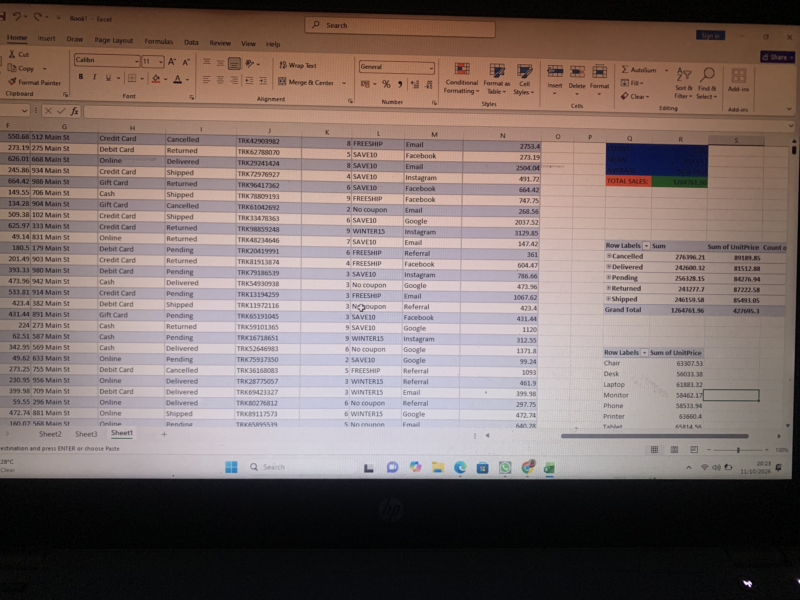
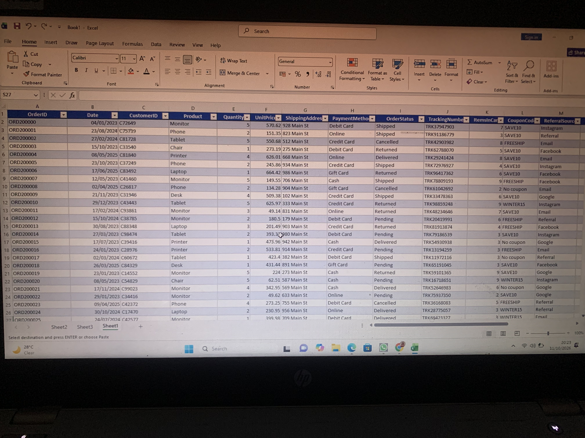

# Exploratory Data Analysis (EDA)

## Project Overview

This project focuses on Exploratory Data Analysis (EDA), where I explored a dataset to uncover patterns, identify trends and outliers, and better understand the data.

## Key Activities

- Calculated descriptive statistics, including mean, median, and count.
- Explored data distributions and identified trends and outliers.
- Summarized key observations and insights from the dataset.

## Project Screenshots

### Analysis Output 1

### Analysis Output 2

## Skills Developed

- Data Analysis
- Descriptive Statistics
- Exploratory Data Analysis (EDA)
- Analytical Thinking
- Data Interpretation

## Key Takeaway

This project strengthened my understanding of how to explore raw data, identify meaningful patterns, and extract insights that support informed decision making.